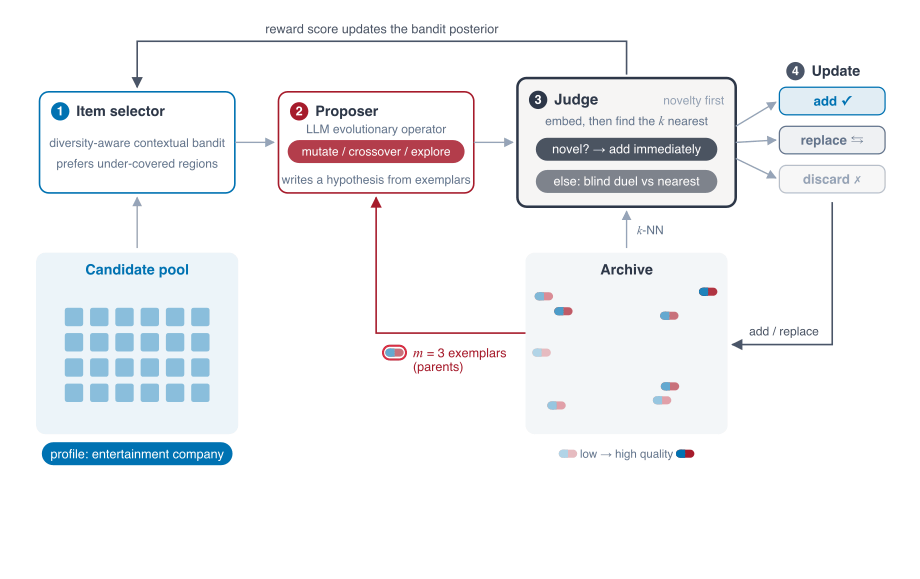

# QD-Rec

[Paper](https://arxiv.org/abs/2610.23470) · [Website](https://pub.sakana.ai/qd-rec/)

Code for the paper "QD-Rec: Open-Ended Evolution of Recommendations via
Quality–Diversity". QD-Rec grows an archive of item–hypothesis
pairs (an item from a fixed pool plus a natural-language reason for recommending it)
under novelty-first admission and local competition, and selects items with a
diversity-aware contextual bandit.

<p align="center">
  
</p>

## Setup

Requires [`uv`](https://docs.astral.sh/uv/) and Python 3.10 or later.

```bash
uv sync
cp .env.example .env    # then fill in the API keys
```

Every model runs through [OpenRouter](https://openrouter.ai), so the only key needed is
`OPENROUTER_API_KEY`: the proposer and the judge (by default both `openai/gpt-6-luna`)
and the embeddings (`openai/text-embedding-3-small`).

## Quick start

Start with the Customers domain, which finds likely customers for a product from
public persona data. This example uses SkillForge, a fictional online learning
platform.

Run QD-Rec, the default method. Novelty and Novelty+Evo are ablations for the paper's
comparisons. The commands below use `openai/gpt-6-luna` as both proposer
and judge for a quick, inexpensive trial. For better recommendation quality,
consider a more capable model by changing `_DEFAULT_LLM_MODEL` and
`_DEFAULT_JUDGE_MODEL` in the domain's `config.py`.

Download the personas, create item embeddings, seed the archive, and run 100 evaluations:

```bash
uv run python -m apps.customers.download_personas
uv run python -m apps.customers.create_embeddings
uv run python -m apps.customers.seed --profile SkillForge
uv run python -m apps.customers.qd_rec --profile SkillForge --iterations 100
```

If you are a researcher, you can use QD-Rec to find papers relevant to your interests.
Open `apps/papers/profiles.py` and add a `"Me"` entry inside the `PROFILES`
dictionary. Describe your research questions, methods, and what makes a paper
useful to you.

Then follow the same four steps, passing your profile name to both seeding and the
main run. The profile guides hypothesis generation and evaluation:

```bash
uv run python -m apps.papers.download_corpus
uv run python -m apps.papers.create_embeddings
uv run python -m apps.papers.seed --profile Me
uv run python -m apps.papers.qd_rec --profile Me --iterations 100
```

### Explore the results

Archives are written to `archives/customers/` and `archives/papers/`. To explore
the results in a browser, create a dashboard:

```bash
uv run python -m shared.view_archive --open                                 # the newest run
uv run python -m shared.view_archive archives/customers/<file>.json --open  # a given archive
```

## Data

The scripts below download and prepare the public datasets.
Each writes into the domain's `data/` directory.
See each dataset's page for their license and terms of use.

**Goodreads.** The [UCSD Goodreads Book Graph](https://mengtingwan.github.io/data/goodreads.html), Children subset. The paper's two readers are set in `apps/books/config.py`.

```bash
bash apps/books/download.sh
uv run python -m apps.books.data_prep
```

**Marketing.** [NVIDIA Nemotron-Personas-USA](https://huggingface.co/datasets/nvidia/Nemotron-Personas-USA),
restricted to California and sampled to 10,000 profiles.

```bash
uv run python -m apps.customers.download_personas
```

**Paper-abstract exploration.** Accepted papers from ICLR 2026, ICML 2026 and
NeurIPS 2025, fetched from [papercopilot/paperlists](https://github.com/papercopilot/paperlists).

```bash
uv run python -m apps.papers.download_corpus
```

**M&A target discovery.** The paper's company data come from LSEG Workspace, which
requires a paid subscription. Instead,
`apps/companies/data/universe_example.csv` gives the expected columns with three
synthetic companies, so that anyone with a subscription can build the table from their
own LSEG export. The M&A scripts read one row per company from
`apps/companies/data/universe_USA.csv`, and the acquirer is one of the rows, named by its
`Instrument`. The table does not need these exact columns: only `Instrument`,
`CompanyName` and `BusinessDescription` are required, and `item_text` in
`apps/companies/items.py` decides which other fields the proposer and the judge see. Company
data from another source should work as well.

**Other domains.** QD-Rec needs only a pool of items with some text for each, and a
profile to recommend for. To try it on your own problem, copy one of the four apps and
adapt its items, profiles and prompts. We'd love to hear what you use it for!

### Item embeddings

Each domain needs a precomputed embedding store for its candidate items (OpenAI
`text-embedding-3-small`, 512 dimensions):

```bash
uv run python -m apps.books.create_embeddings
uv run python -m apps.customers.create_embeddings
uv run python -m apps.papers.create_embeddings
uv run python -m apps.companies.create_embeddings       # only if the M&A data are present
```

## Running the experiments

A run belongs to one profile: build its seed archive, then run the three methods, each
for 1,000 evaluations by default. For example:

```bash
uv run python -m apps.customers.seed --profile Printer3D
uv run python -m apps.customers.qd_rec --profile Printer3D --method novelty
uv run python -m apps.customers.qd_rec --profile Printer3D --method novelty_evo
uv run python -m apps.customers.qd_rec --profile Printer3D    # QD-Rec
```

By default, `openai/gpt-6-luna` is both the proposer and the judge. This is an inexpensive setting for trying the code, but should be changed to a more capable model when we aim for better performance.

### Methods

| Paper name | Entry point | Flags |
|---|---|---|
| Novelty | `qd_rec.py` | `--method novelty` |
| Novelty+Evo | `qd_rec.py` | `--method novelty_evo` |
| QD-Rec | `qd_rec.py` | none (defaults: `--method qd_rec`, `--ts-diversity-beta 1.0`, `--ts-sigma 0.1`) |

The archive files and the `method` labels in them use `novelty`, `novelty_evo` and `qd_rec`,
and `seed` for the initial archive.

### Outputs

Each run writes one JSON archive to `archives/<app>/` (or `$QD_ARCHIVES_ROOT/<app>/`) and
rewrites it after every batch; `metadata.completed_at` is set once the run has finished.
The archive keeps every evaluated item–hypothesis pair, including replaced and discarded
ones, so count the entries whose `status` is `active` to get the final archive.
